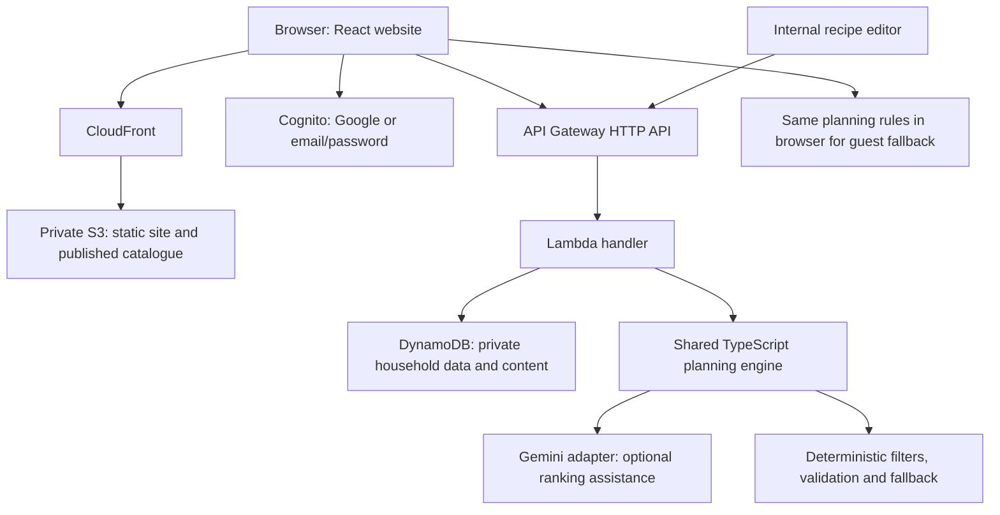

# Meal Planner V1 — System Design

Version 0.3 · 3 November 2026 · Architecture proposal for review.

Companion: [Product requirements](Meal-Planner-V1-PRD.md). This document records subsequent decisions and proposed changes to that initial PRD. No infrastructure has been deployed.

## 1. Confirmed decisions

- TypeScript throughout. AWS account setup is complete as of 3 November 2026. The pilot target is zero out-of-pocket infrastructure or model spending. AWS Billing showed $100 remaining on 3 November 2026 and a credit expiry of 3 November 2027. Check the Free account plan end date separately before provisioning.
- Indian household meals, vegetarian and eggetarian only. English interface with Indian ingredient names and aliases.
- Responsive website; no installation, offline mode, notifications, monetization, shopping lists, leftovers, or household collaboration.
- One account operator and one household-level dietary/allergy profile, with variable servings. No per-person profiles.
- Pantry status: available, low, out; quantities optional.
- Meal, day, and week generation on demand, lunch and dinner only. No scheduled background replanning.
- Food-group balance and explanations; no numeric nutrient targets or micronutrient adequacy claims.
- DynamoDB is accepted for V1. The product owner reviews AI-drafted recipes before publication.
- AI drafts recipes for an internal catalogue. Runtime planning selects from published, reviewed recipes; unrestricted recipe invention is deferred.
- Google sign-in and email/password sign-in, including Gmail addresses. A Gmail password is never requested by our site; an email/password account has its own application password.
- No per-guest daily allowance or subscription wall. Finite provider quotas and system capacity still apply.
- Branding is finalized for Meals Planned. See the [selected logo](design/Meals-Planned-Logo.svg), [branded screens](design/Meals-Planned-Stitch.png), and [Stitch project](https://stitch.withgoogle.com/projects/14274819275338680925?pli=1).

## 2. Proposed stack

| Layer | Proposal | Reason |
|---|---|---|
| Web | React, TypeScript, Vite, Tailwind | Static hosting; no always-running web server |
| Client data | TanStack Query, shared Zod schemas | Explicit request states and shared validation |
| API | Node.js supported Lambda runtime, TypeScript, small HTTP router | One modular application rather than microservices |
| Database | DynamoDB Standard, provisioned capacity | Small-pilot AWS recurring allowances; no relational server baseline |
| Identity | Cognito user pool, Google federation, email/password | Managed credentials, verification and recovery |
| Assets | Private S3 bucket through CloudFront | Static site and versioned public catalogue assets |
| API ingress | API Gateway HTTP API → Lambda | Built-in access-token checks on private routes; low request cost |
| AI | Gemini Developer API, free eligible text model | Replaceable provider; never automatically upgrade to paid usage |
| Infrastructure | AWS CDK in TypeScript | Repeatable deployments and reviewable cost-related configuration |
| Tests | Vitest and Playwright | Domain constraints plus critical browser journeys |

These are proposed libraries, not pinned versions. Resolve supported versions and lock dependencies during implementation setup.

The earlier relational-database suggestion changes to DynamoDB because the AWS/no-spend constraint is now explicit. Tradeoff: access patterns and conditional updates need careful design, and ad hoc relational reporting is less convenient. The small recipe collection does not require vector search, OpenSearch, Redis, or an agent framework.

## 3. Architecture

Use one region initially; Mumbai is the proposed application region, subject to service availability in the chosen account. Lambda runs outside a customer VPC, avoiding a NAT gateway. Cognito and Gemini are external to the request's application process; AWS hosting does not mean Gemini processing stays in AWS or India.

Proposed ingress: explicit public routes for catalogue and guest suggestions; require the HTTP API JWT authorizer on every private route, with Cognito issuer, expected audience/client and an API access scope. Use the OAuth code flow for both Google and email/password sign-in. After token validation, Lambda derives the household partition from the verified subject and requires the controlled recipe-admin group for editorial actions. Never accept ownership or group claims from the request body. Restrict Lambda invocation to the gateway; do not expose a parallel Function URL. With the Function URL alternative, the app would own token verification as well as these resource checks.

## 4. The core experience is automatic

1. User enters pantry and constraints; no recipe authoring is required.
2. User selects one meal, one day, or up to seven days.
3. The planner filters published recipes and builds complete meal combinations.
4. AI may rank valid candidates; deterministic rules validate the resulting schedule.
5. The app displays a complete or partial proposed plan and explains uncertainty.
6. The user optionally swaps/locks meals, then saves the plan.
7. Cooking confirmation updates actual stock and history. Planning alone never consumes stock.

Guests can generate temporary meal/day suggestions. Persisted weekly planning requires sign-in, preserving the guest draft. Generation is a deliberate action, not a cron job. Pantry changes flag affected plans; they do not silently replace accepted meals.

## 5. Recipe supply and AI responsibilities

### Catalogue creation

An administrator requests batches of familiar Indian recipes using an AI model. Output must conform to a schema: canonical ingredients, quantities/yield, instructions, active/total time, advance preparation, equipment, dietary tags, allergens and food-group roles.

Draft → schema validation → human review → published immutable version. AI-generated metadata is not automatically trusted or published. A second model can critique a draft but is not a replacement for review. Store model/prompt version, reviewer, revision and any sources actually consulted; do not fabricate citations. Start with a proposed 40–60 reviewed meal combinations, then measure coverage rather than treating the count as sufficient.

Your Pro subscription may help with manual drafting in AI Studio. Imported structured drafts enter the same review workflow. This separates occasional content-generation work from runtime API availability.

### Runtime generation

- Resolve ingredient aliases locally from the catalogue. Ask the user to clarify ambiguous dal names rather than guessing.
- Filter allergies, vegetarian/egg rules, excluded ingredients, equipment, preparation prerequisites and time in code.
- Form candidate combinations with meaningful protein sources, vegetables/fibre sources, and practical staple pairings. These are composition heuristics, not nutrient guarantees.
- Rank candidates by use-soon priority, balance, effort, variety and recent meals.
- Optionally ask Gemini to rank a bounded set of candidate IDs. It cannot introduce new ingredients, recipes or instructions.
- Validate output IDs and the whole schedule. If invalid, slow, unavailable, or quota-exhausted, use the deterministic ranking and explanation templates.
- Never relax an allergy to fill a slot. Return fewer options or unresolved slots when needed.

No model gets database mutation tools. No model response can publish a recipe or deduct stock.

### Free model policy

Evaluate a currently free-tier eligible Gemini Flash-class text model using representative Indian meal scenarios; keep its model ID in configuration. Do not finalize a model solely from marketing benchmarks or promise a fixed daily quota. Confirm actual project/model limits in AI Studio before launch.

The Gemini pricing page lists a free API tier, while Google AI subscription access and API billing are separate. Free-service data handling also matters: do not send names, email addresses, household allergy records, diagnoses or raw private free text to a free model. Apply sensitive exclusions inside our system and send only minimal food-related candidate data where permitted. Otherwise use local ranking. Explain external processing before enabling runtime AI. Never put an API key in browser code or ask the user to paste it into this document.

## 6. Pantry semantics and stock honesty

Each item has canonical ingredient ID, available/low/out, optional quantity/unit, optional storage/purchase/opening dates, use-soon flag, and revision.

- Unknown quantities remain unknown; available does not mean enough for fourteen meals.
- Known compatible quantities support arithmetic reservations. Unknown quantities produce planned-use references and a needs-confirmation flag, not invented gram balances.
- Low stock triggers caution and quantity confirmation; it is not a numeric amount.
- After cooking, show used ingredients and let the user confirm available/low/out. Offer exact deductions only where quantity and conversion are known.
- Optional quantities do not imply mandatory weighing.
- Use-soon priority is based on reviewed storage guidance and user input, never an invented expiry date. Spoiled/discarded items are excluded.

One active editable plan per account avoids overlapping reservations in V1. Plan slots can be planned, cooked, skipped, eating-out, or unresolved; locked is a separate flag. Locked selections stay visible if newly infeasible.

## 7. Data and access patterns

Use two tables initially, without secondary indexes until an access pattern needs them. Bound the pilot catalogue so loading published metadata is inexpensive; do not scan user data for requests.

| Table / key pattern | Records |
|---|---|
| AppData: PK USER#subject, SK PROFILE | Household defaults and revision |
| AppData: PK USER#subject, SK PANTRY | Bounded pantry document and revision |
| AppData: PK USER#subject, SK PLAN#ACTIVE | Up to 14 slots, recipe-version references, expected pantry/preferences revisions |
| AppData: PK USER#subject, SK EVENT#time#id | Cooking and stock-change history |
| AppData: PK USER#subject, SK FAV#mealId | Favourites and feedback |
| AppData: PK USER#subject, SK IDEMP#key | Mutation result and expiry |
| Catalogue: PK RECIPE#id, SK VERSION#version | Immutable draft/published recipe content |
| Catalogue: PK CATALOGUE, SK MANIFEST | Current published versions and catalogue revision |
| Catalogue: PK INGREDIENT#id, SK METADATA | Aliases, units, allergens, food-group roles |

Set explicit item-size and input bounds; a proposed maximum 100 pantry entries and 14 plan slots keeps aggregate documents manageable. Validate serialized size below DynamoDB's item limit; split aggregates if future scope exceeds it. Keep recipe instructions outside the active plan; retain immutable versions for historical rendering.

Owner-partition queries support history pagination and account deletion. TTL cleans expired idempotency/cache records eventually; application code must enforce expiry itself. Public recipe bundles contain only published content. Private responses are not CDN cached.

## 8. API outline

| Route | Behaviour |
|---|---|
| GET /catalogue | Published catalogue revision / asset location |
| POST /suggestions | Guest-compatible suggestions; bounded input, optional AI |
| GET/PATCH /me | Own household profile |
| GET/PATCH /pantry | Own stock, conditional revision |
| POST /plans/generate | Generate proposal from explicit snapshot; no stock mutation |
| PUT /plans/active | Save validated proposal with revision checks |
| POST /plans/active/swap | Propose replacement preserving locks |
| POST /cooking-events | Confirm cooking and stock changes atomically |
| POST /cooking-events/:id/undo | Conditional reversal or reconciliation |
| GET /history; PUT/DELETE /favourites/:id | Own history and preferences |
| DELETE /me | Account/data deletion workflow |
| /admin/recipes/* | Draft, validate, review and publish; internal role required |

Every mutation accepts an idempotency key where retries could duplicate work, and a revision where concurrency could overwrite data. Error categories include invalid input, unauthenticated, forbidden, stale snapshot, insufficient candidates and temporarily unavailable.

Generation runs as a bounded synchronous request initially: deterministic selection plus at most one tightly timed model call. Target an approximately 8-second model deadline and fast fallback; benchmark before committing a UI latency promise. Avoid a queue/worker at launch because it adds little when inference can time out safely. Add queued jobs only if measured needs justify longer generation; content drafting can initially use manual AI Studio imports.

## 9. Consistency and failure recovery

- Cook: transact pantry revision update, event creation, plan update and idempotency record together. Either all succeed or none do.
- Retry with the same key returns the original result. Do not depend solely on DynamoDB's temporary transaction deduplication window.
- Undo checks affected revisions. If stock changed later, show reconciliation; never restore a stale whole-pantry snapshot.
- Generated proposals carry pantry, preferences and catalogue revisions. If these change before save, revalidate instead of silently saving a stale plan.
- Allergy changes and withdrawn recipe versions invalidate affected future slots. Historical cooking records retain original recipe versions.
- Provider timeout/429/invalid JSON uses local ranking, without aggressive retry loops. Tell the user when catalogue-based fallback was used; do not present it as a fresh AI response.
- Guests retain inputs in session storage. On sign-in, preview merge with existing inventory. Logout clears private query caches and browser state.

## 10. Identity and privacy

Use Cognito's authorization-code flow with PKCE for Google sign-in. Email/password signup includes verification, recovery and logout. Never store passwords in application tables. Use short-lived tokens, avoid logging them, and clear local session data on logout. Admin access is enforced server-side through a controlled role; a hidden navigation item is insufficient.

Do not merge Google and password accounts solely because their email strings match. Require authenticated proof for account linking or keep them separate with clear messaging until a linking flow exists.

Use least-privilege IAM, private S3 access, encrypted managed storage and restrictive CORS. Store the Gemini key only in server-side secret configuration. Log request IDs, timings and failure categories, not allergies, pantry narratives, credentials or full prompts. Account deletion covers profile, pantry, plans, history, preferences and identity; document limited backup retention.

## 11. Cost feasibility and operating limits

**No-spend pilot is a target with eligibility and duration conditions, not a promise of unlimited free hosting.** AWS documents a Free account plan lasting up to six months or credit exhaustion, whichever is earlier, with no charges unless upgraded. A new account is not by itself proof of new-customer promotional eligibility, especially if its owner has used AWS before. Verify the actual signup offer and eligible services.

Proposed configuration:

- Use the Free account plan if eligible; no automatic paid upgrade. Review continuation before expiry.
- Consider CloudFront's $0 flat-rate plan for static hosting, subject to supported origins/features and allowances. Confirm S3 credits and requests rather than assuming all S3 use is free.
- DynamoDB Standard provisioned capacity, initially 2 read/2 write units per table, no autoscaling. AWS lists 25 provisioned read/write units and 25 GB under its applicable allowance; other account resources/indexes share relevant limits. On-demand request pricing is not the same as provisioned free capacity.
- Mumbai HTTP API request pricing: $1.05/million in the first tier, or $0.105 for 100,000 small metered calls before any free offer or credits. This excludes transfer, logging, Lambda and other services. Check the account’s actual offers; do not assume free entitlement.
- Low Lambda reserved concurrency and bounded runtime. Avoid NAT gateway, load balancer, RDS, provisioned Lambda concurrency and paid AI fallback.
- Short diagnostic-log retention, no unnecessary tracing, no custom domain purchase for the pilot.
- Cognito's direct/social sign-in free tier is generous for this pilot, but its default email sender has a separate 50-email/day account quota. Verification and recovery can hit it even when MAU charges are zero.
- Backups, logs, deployment artifacts, S3 requests and transfer can consume credits. Budget alerts are notifications, not hard spending caps. Plan a small encrypted backup and test restore; verify its cost before enabling it.

There is no product-level daily guest quota. Payload bounds, duplicate-request suppression and bounded concurrency protect basic availability. When model quota is exhausted, use catalogue planning; when infrastructure capacity is exhausted, display a recoverable busy response. Guest-side deterministic fallback reduces backend reliance but does not make hosting unlimited.

## 12. Validation and release plan

1. Review this design and actual AWS/Gemini account entitlements.
2. Branding is finalized for Meals Planned. See the [selected logo](design/Meals-Planned-Logo.svg), [branded screens](design/Meals-Planned-Stitch.png), and [Stitch project](https://stitch.withgoogle.com/projects/14274819275338680925?pli=1).
3. Establish a reviewed recipe sample and balance/use-soon rules.
4. Build the shared planning engine and evaluate coverage, allergies, quantities and one-hob timing.
5. Deliver guest suggestions end to end, including provider-unavailable fallback.
6. Add identity, pantry, saved plans and atomic cooking/undo.
7. Add history/admin workflows and test privacy, recovery and restore.
8. Run the small household pilot, then revisit scale and paid-service decisions.

Required tests include authorization across accounts, allergy conflicts, egg exclusion, unknown stock across 14 slots, incompatible quantity units, concurrent edits, duplicated cooking requests, undo after later changes, preserved locks, incomplete plans, malformed model output and exhausted model quota. Test account verification/recovery and guest-to-account merge in the browser. No infrastructure or model purchases are authorized by this draft.

## 13. Decisions still requiring review

- Review the proposed HTTP API ingress and static React frontend.
- Arrange qualified input for the initial nutrition/storage guidance; recipe editorial review is assigned to the owner.
- Confirm the actual AWS Free account eligibility after signup and Gemini free model/quota in AI Studio. Share model names and quota values only, not keys.
- Confirm regional coverage for the initial recipe set; proposed mixed familiar Indian home meals, expanded through pilot feedback.

## 14. Official references checked for this draft

- [AWS Free Tier and account plans](https://docs.aws.amazon.com/awsaccountbilling/latest/aboutv2/free-tier.html)
- [CloudFront pricing](https://aws.amazon.com/cloudfront/pricing/)
- [DynamoDB pricing](https://aws.amazon.com/dynamodb/pricing/)
- [Cognito pricing](https://aws.amazon.com/cognito/pricing/)
- [Cognito quotas, including email](https://docs.aws.amazon.com/cognito/latest/developerguide/quotas.html)
- [AWS Mumbai API Gateway price list (CSV)](https://pricing.us-east-1.amazonaws.com/offers/v1.0/aws/AmazonApiGateway/current/ap-south-1/index.csv)
- [API Gateway pricing and free offers](https://aws.amazon.com/api-gateway/pricing/)
- [HTTP API JWT authorizers](https://docs.aws.amazon.com/apigateway/latest/developerguide/http-api-jwt-authorizer.html)
- [Gemini API pricing and free-tier data use](https://ai.google.dev/gemini-api/docs/pricing)
- [Gemini project rate limits](https://ai.google.dev/gemini-api/docs/rate-limits)
- [Google AI subscription plans and API usage](https://ai.google.dev/gemini-api/docs/google-ai-plans)
- [Gemini API terms](https://ai.google.dev/gemini-api/terms)

Provider terms and quotas can change. Recheck actual account settings immediately before deployment; no account-specific quota has been verified in this design session.
